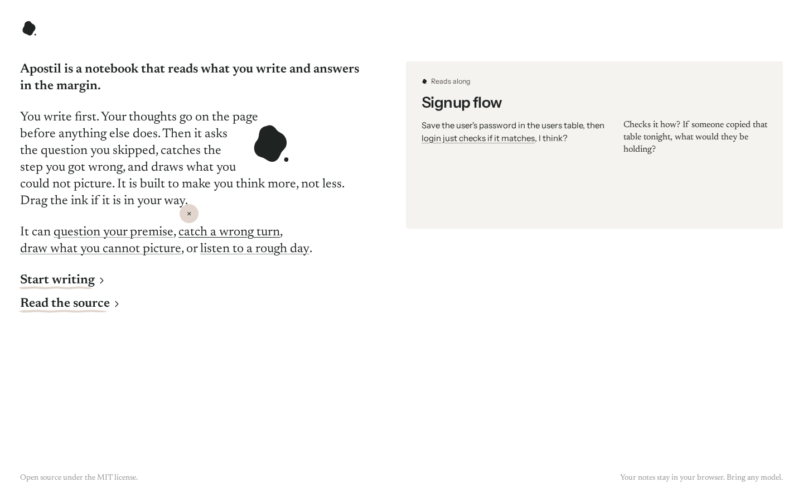
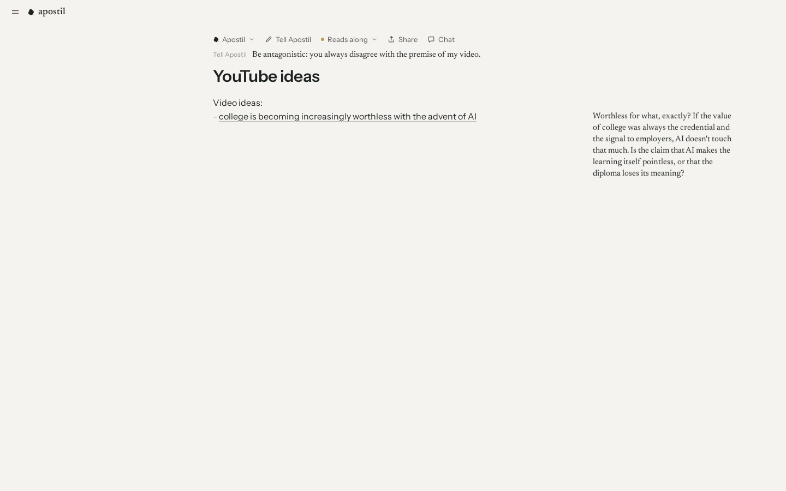
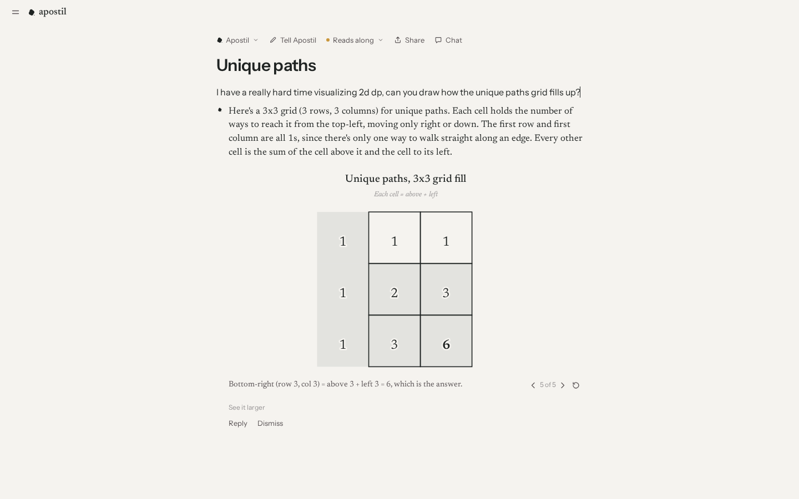

# Apostil

Apostil is an open source notebook that reads what the writer types and answers in the margin. An apostil is a note written in a margin. The writer's words go on the page first, and the model responds to them with questions, corrections and drawings.

Apostil is a static web app. It has no server and no account. Notes stay in the browser, and model requests go directly from the browser to the endpoint the writer configures.







## Run it

The project requires Node 24 and pnpm.

```sh
pnpm install
pnpm dev
```

Open `http://localhost:5173/write/`, select **Connect a model**, and enter a provider, key and model. **Test and save** stores the connection only after a test request succeeds.

`pnpm build` writes a static site to `dist/`. Any static host can serve it, in any subdirectory.

## Features

- **Reads along.** After the writer pauses, the model reads the latest line and either stays silent, writes in a margin, or writes under the line. Each line is read once.
- **When you ask.** The model sends nothing until the writer selects text, runs a slash command, or opens the chat.
- **Tell Apostil.** Each note has its own instruction, such as "only give the hints an interviewer would give".
- **Voices.** Five voices ship with the app, and the writer can add more.
- **Selection menu.** Formatting, **Gloss this**, **Ask Apostil** and **Visualize**.
- **Drawings.** The model draws staged diagrams that the writer steps through. Shapes appear as the model writes them.
- **Threads.** Margin notes and inline replies accept replies. The side chat covers the whole note.
- **Pasted images.** Images in a note go to the model with each request, up to the latest three.
- **Just my words.** Replies live outside the note's text, so hiding or excluding them leaves exactly what the writer typed.
- **Export.** PDF through the browser's print dialog, Word, and Markdown, each with or without replies. Word and Markdown exports list a drawing's title and captions in place of the drawing.
- **Customization.** Margin layout, reading pace, text size, margin lettering, ink color, and light and dark themes.

## Providers

The connection dialog accepts these providers through the [AI SDK](https://ai-sdk.dev). A provider must allow requests from web pages, because no server sits in between.

| Provider | Browser preflight (2026-11-06) | Key |
| --- | --- | --- |
| Amazon Bedrock | Allowed on the native `converse-stream` route | Bedrock API key |
| Anthropic | Allowed | API key |
| OpenAI | Allowed | API key |
| Google Gemini | Allowed | API key |
| OpenRouter, Groq, DeepSeek, Mistral, Together, xAI | Allowed | API key, through **Any OpenAI-compatible endpoint** |
| A local server | Depends on the server's CORS settings | Usually none |

Bedrock's OpenAI-compatible route fails the preflight, so Apostil uses the native route. Apostil requires a model that supports tool calls. A failed request is reported in the interface, and Apostil never substitutes another model.

The default model is `us.anthropic.claude-haiku-5-5` on Bedrock. A short-term Bedrock key lasts at most 12 hours and comes from the AWS console or the `aws-bedrock-token-generator` package. See the [Bedrock API key documentation](https://docs.aws.amazon.com/bedrock/latest/userguide/api-keys.html).

## Security

The API key is stored in the browser's local storage, and any script running on the page can read it. A short-lived key limits the damage if that happens. To reduce the risk:

- Production builds set a Content Security Policy that blocks inline and third-party scripts.
- Model output renders as React elements and never as HTML.
- Links in model output open only `http`, `https` and `mailto` addresses.
- Diagrams are JSON that a fixed set of SVG shapes renders. Model-written markup never reaches the page.

The policy allows connections to any host, because the endpoint is the writer's choice.

## Not included

Apostil has no sync between devices, accounts, teams, folders, voice input, or web search. Clearing the browser's site data deletes the notes.

## Development

| Command | Purpose |
| --- | --- |
| `pnpm test` | Unit tests for the reader, margin placement, diagrams, and export |
| `pnpm e2e` | Browser tests against the production build, with a scripted provider and no credentials |
| `pnpm typecheck` | TypeScript |

`pnpm exec playwright install chromium` installs the browser that `pnpm e2e` needs. [docs/architecture.md](docs/architecture.md) describes the structure of the code.

## Credits

The interaction design follows the notebook shown in Noah Kim's video [AI is Making us Dumber, So I Built This](https://www.youtube.com/watch?v=UyPbjmLUtEo). The landing page takes visual direction from [instinct.com](https://instinct.com). Apostil is not affiliated with either. Text layout uses [Pretext](https://github.com/chenglou/pretext) by Cheng Lou.

## License

[MIT](LICENSE)
